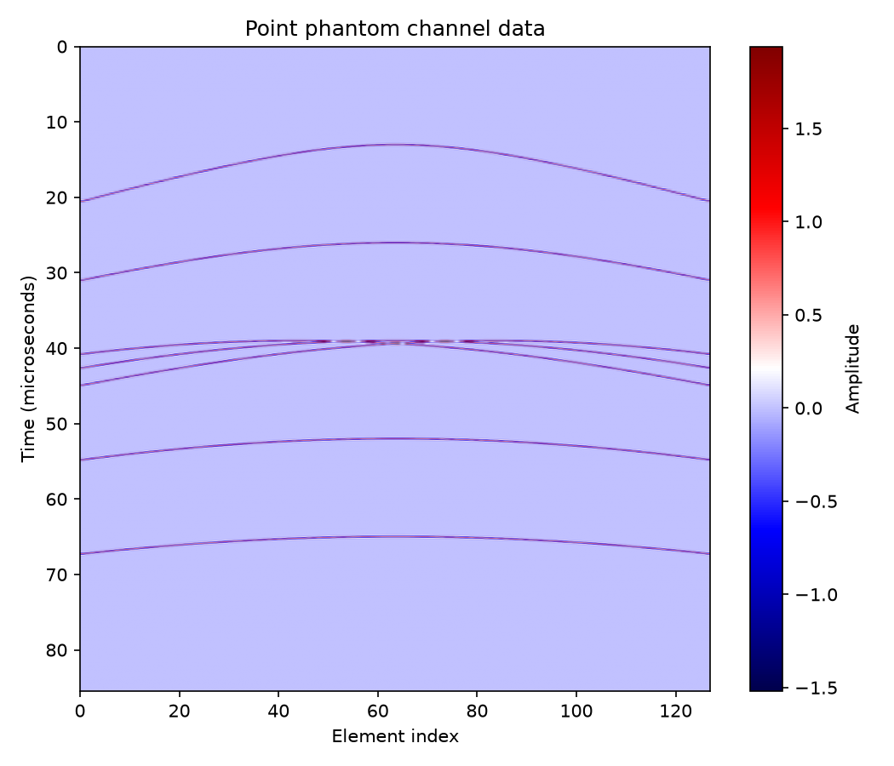
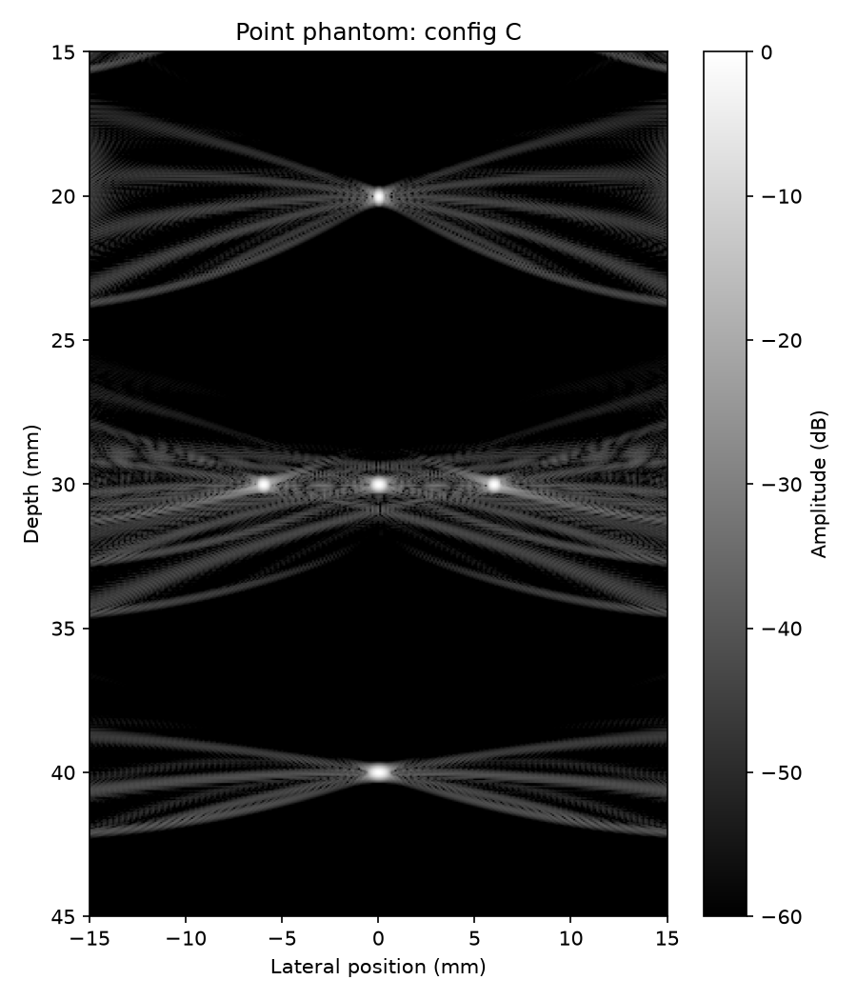
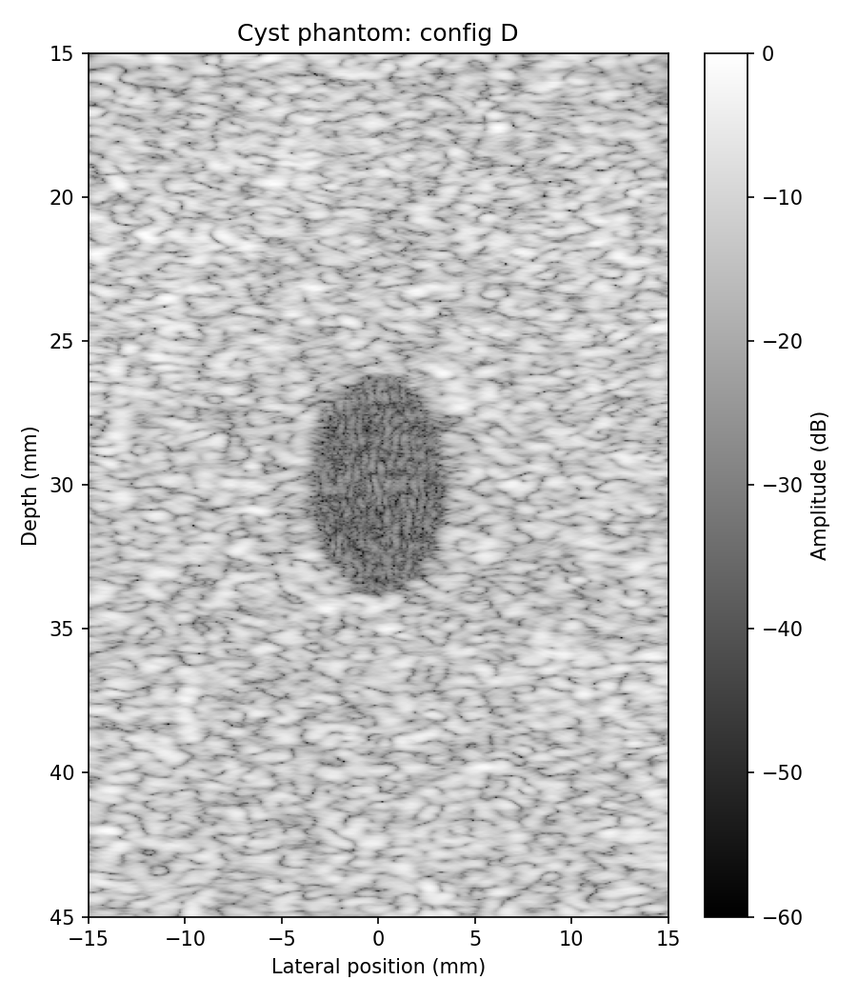
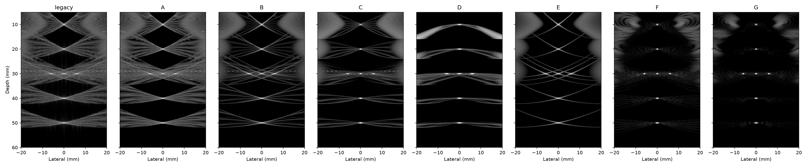

# Ultrasound DAS Beamformer

This project is a delay-and-sum beamformer validated on deterministic simulated data.
It is a student project. It is not a medical device.

The local simulator produces point targets and a speckle phantom with an anechoic cyst.
The beamformer forms an analytic channel signal before it sums delayed channels.
Parameters are similar to published plane-wave research settings. No PICMUS data is used.

## Run

```text
python -m pip install -r requirements.txt
pytest -q
python run_demo.py
```

The demo creates `results/ablation.csv`, `results/metrics.json`, and the figures below.









## Results

The table is written by `run_demo.py` from `results/ablation.csv`.

<!-- RESULTS:START -->
| Config | Lateral FWHM (mm) | PSL (dB) | CR (dB) | CNR |
|---|---:|---:|---:|---:|
| legacy | 0.2043 | -14.54 | 7.95 | 1.003 |
| A | 0.1456 | -14.76 | 7.90 | 1.006 |
| B | 0.2101 | -16.16 | 10.44 | 1.197 |
| C | 0.3408 | -20.61 | 10.20 | 1.206 |
| D | 0.6461 | -15.00 | 10.63 | 1.273 |
<!-- RESULTS:END -->

See [the measured CSV](results/ablation.csv) and [the full metrics](results/metrics.json).

## Limitations

- Simulated data only.
- One plane wave at normal incidence.
- No attenuation.
- No element directivity.
- No speed-of-sound error.
- No depth gain compensation.
- No transmit time offset.
- Not tested on real data.
<!-- RESULTS:START -->
| Config | Lateral FWHM (mm) | PSL (dB) | CR (dB) | CNR |
|---|---:|---:|---:|---:|
| legacy | 0.2043 | -14.54 | 7.95 | 1.003 |
| A | 0.1456 | -14.76 | 7.90 | 1.006 |
| B | 0.2101 | -16.16 | 10.44 | 1.197 |
| C | 0.3408 | -20.61 | 10.20 | 1.206 |
| D | 0.6461 | -15.00 | 10.63 | 1.273 |
<!-- RESULTS:END -->
