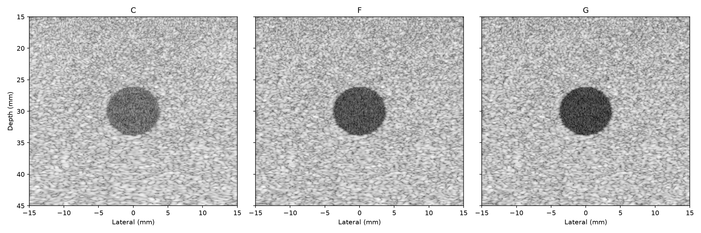
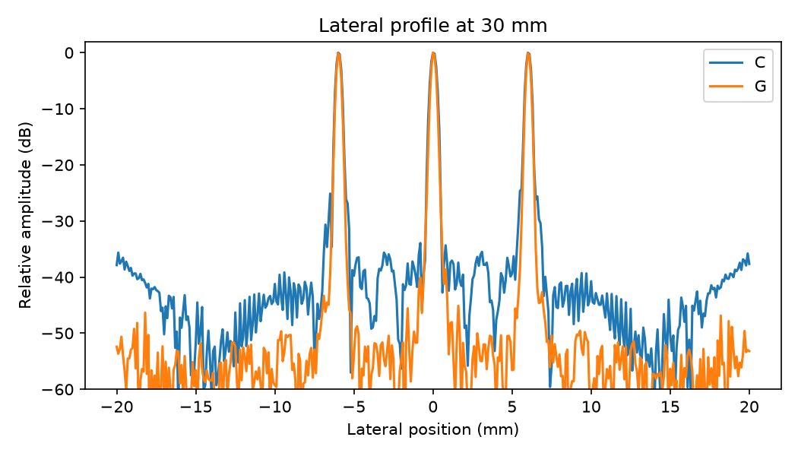

# Ultrasound DAS Beamformer

This project is a delay-and-sum beamformer validated on deterministic simulated data. It is a student project, not a medical device. Simulated data only. Real-data validation is open work.

The local simulator produces point targets and a speckle phantom with an anechoic cyst. The beamformer forms analytic channel data before summing delayed channels. Parameters are similar to published plane-wave research settings. No PICMUS data is used.

## Run

```text
python -m pip install -r requirements.txt
python -m pytest -q
python run_demo.py --quick
python run_demo.py
```

Run `make verify` to run the tests and check that the generated findings match the recorded CSV and JSON files. To refresh the README measurements after a full demo, run `python -m tools.render_readme`.

The quick demo compares cyst configurations C and G. It writes to `results_quick/` and `figures_quick/`. The full demo creates the release measurements in `results/` and the figures below. Its recorded runtime is listed in Findings.





## Findings

The table reports measured results from the seeded ablation. FWHM is
measured at -6 dB. CR and CNR are means with sample standard deviations.
The table values are rendered from `results/ablation.csv`.

| Config | FWHM (mm, -6 dB) | ISLR (dB) | PSL (dB) | Shallow clutter (dB) | CR (dB, mean +/- std) | CNR (mean +/- std) |
|---|---:|---:|---:|---:|---:|---:|
| legacy | 0.3089 | -19.55 | -15.10 | -39.50 | 8.35 +/- 0.25 | 1.042 +/- 0.030 |
| A | 0.3089 | -19.23 | -14.73 | -39.41 | 8.44 +/- 0.27 | 1.051 +/- 0.032 |
| B | 0.3116 | -22.12 | -15.23 | -40.33 | 16.19 +/- 0.50 | 1.465 +/- 0.036 |
| C | 0.4918 | -26.95 | -30.99 | -35.79 | 18.65 +/- 0.24 | 1.534 +/- 0.017 |
| D | 0.9431 | -27.97 | -26.97 | -39.68 | 19.17 +/- 0.45 | 1.618 +/- 0.035 |
| E | 0.3064 | -23.25 | -14.79 | -40.81 | 19.03 +/- 0.80 | 1.541 +/- 0.042 |
| F | 0.4199 | -34.13 | -37.72 | -44.42 | 25.00 +/- 0.23 | 1.621 +/- 0.020 |
| G | 0.4066 | -35.89 | -38.87 | -50.43 | 28.33 +/- 0.23 | 1.648 +/- 0.020 |

Config A (nearest sampling) and config B (linear interpolation) have
similar measured lateral FWHM (0.3089 and 0.3116 mm). B raises CR by 7.75 dB and CNR by 0.414 relative to A.

Config C adds Hann weighting to B: lateral FWHM widens by 0.1802 mm, while PSL improves by 15.76 dB.

Config E adds fourfold upsampling to the linear, unweighted config B: CR rises by 2.84 dB and CNR by 0.077; lateral FWHM changes by -0.0053 mm.

The legacy/A comparison is consistent with no clear image-quality gain from Hilbert-before-sum in this dataset. It does not isolate Hilbert placement from the other implementation differences.

Relative to single-angle config C, five-angle config F changes measured CR by +6.35 dB, CNR by +0.087, and shallow clutter by -8.63 dB. Eleven-angle config G changes those metrics by +9.68 dB, +0.114, and -14.64 dB.

## Sound-speed robustness

The expected displacement is `dz = z (c_assumed / c_true - 1)`. Recorded values below are generated from `results/sound_speed.json`.

| Assumed speed (m/s) | Predicted shift (mm) | Measured shift (mm) |
|---:|---:|---:|
| 1500 | -0.7796 | -0.7530 |
| 1580 | 0.7796 | 0.7750 |

## Compounding

The implementation evaluates steering angles through +/-15 degrees. The measured results show the contrast, CNR, and shallow-clutter changes above. The recorded full demo took 1331.3236 seconds; its measurements are preserved in `results/`.

## Limitations

- Simulated static phantoms only; tissue motion is not modeled. Real-data validation is open work.
- Coherent compounding requires multiple transmissions per image and reduces achievable frame rate.
- Steering is limited to the implemented +/-15 degrees.
- Sound-speed error is tested only as a uniform mismatch.
- Attenuation, element directivity, and depth-gain compensation are not modeled.

## Theory (not measured results)

For a Rayleigh envelope, the theoretical maximum `mu_out / sigma_out` is `sqrt(pi / (4 - pi)) = 1.913`. This theoretical limit is not the measured CNR of this phantom.

For maximum depth `z_max`, the ideal pulse-repetition-frequency bound is `PRF_max = c / (2 z_max)`. The corresponding ideal compounded frame-rate bound is `f_frame = PRF_max / K`. Using the project sound speed, image depth, and angle count gives `PRF_max = 12.8 kHz`; for `K = 11`, `f_frame = 1.2 kHz`. These theory bounds exclude system overhead and are not measured frame rates.

## Recorded outputs

See [the measured CSV](results/ablation.csv), [full metrics](results/metrics.json), [sound-speed results](results/sound_speed.json), and [runtime record](results/runtime.json).
